# A-SPSA и глобальный буфер на реальных исходах LLM

Полный материал для статьи:
- данные, архитектура, модель вызовов и задержки;
- две постановки оптимизации (слой предикторов и политика планировщика),
  методы с формулами, параметры теории;
- с кем сравниваем, метрики, протокол, проверки и тесты;
- результаты и рисунки с пояснениями;
- что утверждает статья и её ограничения (раздел 10).

Все числа воспроизводятся командами из раздела 11. Каждый каталог результатов
содержит `experiment_manifest.json` с ревизией кода и полной конфигурацией.

---

## 0. Главные результаты

**Оптимизатор: A-SPSA против SPSA, ZO-GT, ZO-PGD**

| Что сравниваем | Результат | Статистика |
|---|---|---|
| Слой предикторов, равный шаг h ∈ {0.001, 0.01}, LLMRouterBench | out-of-sample F1 **−12…−48 %**, held-out MAPE времени **−16…−33 %**, функционал Φ_p **−18…−39 %** во всех трёх режимах | **36/36** значимы, p_holm ≤ 0.023, 9–10/10 seed |
| То же на втором бенчмарке (SPROUT), **без подбора**, h = 0.01 | F1 **−25…−31 %**, MAPE **−17…−24 %**, Φ_p **−30…−35 %** против SPSA, ZO-GT и одного RLS | **27/27**, 10/10 seed, p_holm = 0.006 |
| RLS + A-SPSA против одного RLS (h = 0.01) | F1 **−32…−50 %**, MAPE **−20…−33 %**, Φ_p **−35…−41 %** | 9–10/10 seed, p_holm = 0.018 |
| Политика планировщика, шаг манускрипта, малошумный оракул | доля дедлайнов **0.919 против 0.905–0.909**; A-SPSA — **единственный метод выше EDF** (0.913) | 9/9 seed, p_holm ≤ 0.023; против EDF 8/9, p = 0.020 |
| Без подбора шага против методов с подобранным шагом (политика) | A-SPSA за **300 вызовов** — 0.919 (выше EDF); остальным для уровня выше EDF нужен подбор шага (**~4 500 вызовов, в 15 раз больше**), после которого все методы дают 0.921–0.924 | 9 seed; с подбором различия незначимы |
| Скорость сходимости | уровень, которого лучший конкурент достигает к 30-му раунду, A-SPSA достигает **к 7-му** (политика); на слое предикторов — **к 3–17-му раунду из 98** | малошумный оракул; h = 0.01 |
| Вклад ускорения (абляция) | около 2/3 выигрыша над SPSA при малошумном оракуле (+0.8 п.п. к постоянному шагу); при обычном оракуле — 0 | 8/9 seed, p_holm = 0.059 |

**Маршрутизация: архитектура против роутеров из литературы**

| Что сравниваем | Результат | Статистика |
|---|---|---|
| API: против роутера с той же офлайн-оценкой (kNN / MLP из RouterBench) | качество **+0.023 / +0.028**, AIQ **+0.025 / +0.025** | 10/10 seed, p_holm ≤ 0.020 |
| API: против лучшей одиночной модели (GPT-5) | с MLP-приором качество **0.589 против 0.580** при цене **на 20 % ниже** | те же промпты |
| API: против коммерческого OpenRouter auto-router | качество **0.567–0.589 против 0.500** при сопоставимой цене | те же промпты |
| Под нагрузкой (взвешенный приоритет в буфере): против роутера с той же офлайн-оценкой (kNN / MLP) | дедлайны **+4.7…+8.0 п.п.**, p95 latency **−77…−365 с** | 9–10/10 seed, p_holm ≤ 0.035 |
| Устойчивость к профилям задержки (6 вариантов) | дедлайны выше kNN и выбора по домену в **5 из 6** вариантов, **+2.5…+14 п.п.**; когда все модели вдвое быстрее, различий нет | 10 seed на вариант, Холм |
| Второй бенчмарк (SPROUT) | качество **+0.013…+0.015** под нагрузкой против kNN-роутера и выбора по домену; дедлайны на уровне роутеров (модели быстрые и однородные) | 8–9/10 seed, p ≤ 0.014 |

**Порядок очереди**

| Что сравниваем | Результат | Статистика |
|---|---|---|
| Система: EDF против взвешенного приоритета с ручными весами | дедлайны **0.926 против 0.743** (capacity) при качестве 0.461 против 0.470; с EDF все роутеры на одном уровне (0.91–0.93) | 10/10 seed, p_holm = 0.006 |
| Политика, найденная A-SPSA, под нагрузкой ρ = 1…3 | на уровне EDF (±1 п.п.) и выше методов без ускорения; при ρ = 3 — **0.918 против 0.890–0.899** | 9 seed × 2 потока |
| Задачи в срок за test-поток (ρ = 2) | **275.6 против 271.5–272.8** (методы нулевого порядка) и 258.4 (ручные веса) | 45 прогонов |

---

## 1. Данные

### 1.1 Исходы моделей: LLMRouterBench

[LLMRouterBench](https://github.com/ynulihao/LLMRouterBench) (Li et al., 2026),
режим performance–cost. Флагманские модели вызваны через API, и **для каждого
промпта** записаны ответ, оценка, число входных и выходных токенов и стоимость
вызова в долларах. HF `NPULH/LLMRouterBench`, ревизия `0e5af1b`, лицензия MIT.

**Модели (11):** Claude Sonnet 4, DeepSeek-R1-0528, DeepSeek-V3-0324,
DeepSeek-V3.1-Terminus, Gemini 2.5 Flash, Gemini 2.5 Pro, GLM-4.6, GPT-5,
Intern-S1, Kimi-K2-0905, Qwen3-235B-A22B-2507.

**Задачи (12 096 промптов), шесть доменов:**

| Домен | Датасеты | Промптов | Как оценивается ответ |
|---|---|---:|---|
| knowledge | MMLU-Pro (3000), GPQA (198) | 3 198 | точное совпадение |
| math | AIME (60), LiveMathBench (121) | 181 | точное совпадение |
| code | LiveCodeBench (1055) | 1 055 | исполнение тестов |
| software_engineering | SWE-bench Verified (500) | 500 | тесты репозитория |
| factual_qa | SimpleQA (4326), HLE (2158) | 6 484 | точное совпадение / судья |
| agentic_reasoning | τ²-bench (278), ARC-AGI v1 (400) | 678 | успех эпизода / точное совпадение |

**Лучшая модель по домену** (среднее качество):
- GPT-5 в knowledge, math, code и agentic;
- Gemini 2.5 Pro в factual_qa;
- Claude Sonnet 4 в software_engineering.

Лучшая одиночная модель — GPT-5 (0.576), per-prompt oracle — 0.796. **Запас
маршрутизации 0.22.**

**Сплит:** 60/20/20 по хэшу идентификатора промпта; test — 2 408 промптов. Всё,
что система знает до исполнения задачи (профили моделей, трудность,
kNN-оценки, PCA-базис эмбеддингов), вычисляется **только по train**.

**Внешняя опорная точка:** на тех же промптах авторы бенчмарка прогнали
коммерческий **OpenRouter auto-router** и записали по каждому промпту выбранную
модель, качество и стоимость (покрытие test-потока 98 %).

### 1.2 Поток задач: реальная трасса нагрузки

Моменты поступления задач взяты из **Azure LLM Inference Trace 2023, coding**
(Microsoft, CC-BY), 8 819 запросов. Для каждого прогона берётся случайное
непрерывное окно трассы; интервалы нормируются на среднее и масштабируются под
нагрузку ρ:

```
gap_i = trace_gap_i / mean(trace_gaps) / (ρ · C)
```

`C` — ёмкость пула (раздел 3.4). Всплески и одновременные поступления
реального сервиса сохраняются.

### 1.3 Второй бенчмарк: SPROUT

[SPROUT](https://huggingface.co/datasets/CARROT-LLM-Routing/SPROUT) (Somerstep
et al., CARROT, 2025), ревизия `d54e3cd`. Для каждого промпта записаны ответы
13 моделей, оценка судьи против эталона и числа токенов. Цена вызова — по
таблице цен авторов CARROT.

**Модели (13):**
- Claude 3.5 Sonnet, Titan Text Premier;
- GPT-4o, GPT-4o-mini;
- Granite 3 (2B, 8B);
- Llama 3.1 (8B, 70B, 405B), Llama 3.2 (1B, 3B), Llama 3.3 70B;
- Mixtral 8x7B.

**Задачи:** 13 273 промпта в шести доменах:
- instruction — 5 785;
- knowledge (MMLU-Pro) — 3 522;
- math (MATH) — 3 027;
- rag_general — 406;
- science_reasoning (GPQA, MuSR) — 381;
- rag_financial_legal — 152.

Test — 2 714 промптов. Лучшая одиночная модель — GPT-4o (0.840),
per-prompt oracle — 0.975.

По сравнению с LLMRouterBench модели здесь быстрее и дешевле, а запас
маршрутизации меньше (0.135 против 0.22). Задержка — по той же модели
(раздел 3.2). Медиана 4.2 с, поэтому единица времени 10 с: по тому же правилу
медиана ≈ 0.5 единицы, максимум < P_max.

---

## 2. Архитектура

```
задача → признаки → контроллер j (балансировка нагрузки)
       → контроллер оценивает все пары (задача i, агент k): s_jik
       → глобальный буфер: приоритет P_jik(t), точное паросочетание
         ожидающих задач и свободных агентов
       → агент исполняет → исход (качество, время, стоимость)
       → обратная связь контроллеру j: RLS после каждого исхода,
         синхронизация контроллеров раз в H_sync исходов
```

**Агент — слот обслуживания модели.** Слот обслуживает одну задачу за раз. У
модели может быть несколько слотов; их число = инстансы × конкурентность
инстанса, как в модели ёмкости Markovic-Voronov et al. (CAIS 2026). Слоты одной
модели делят один предиктор.

### 2.1 Признаки пары (задача i, агент k)

| Координаты | Смысл | Диапазон |
|---|---|---|
| 6 | one-hot домена | {0,1} |
| 1 | трудность `h_i` (раздел 3.3) | [0,1] |
| 1 | длина промпта `min(|s|/800, 1.5)/1.5` | [0,1] |
| 1 | признак кода в промпте | {0,1} |
| 8 | эмбеддинг промпта (раздел 2.2) | ‖e‖ ≤ 1 |
| 1 | офлайн-оценка качества модели k на промпте i, `q̃_ik` | [0,1] |
| 2 | занятость пула, давление очереди | [0,1] |

Вектор делится на верхнюю границу нормы `X = √8`, так что `‖x‖ ≤ 1`, как
требуют константы Липшица манускрипта (`X_max = Z_max = 1`).

### 2.2 Эмбеддинг промпта и офлайн-оценка качества

- **Эмбеддинг:** `sentence-transformers/all-MiniLM-L6-v2` (384 измерения,
  первые 256 токенов), затем PCA до 8 компонент по train. Вектор масштабируется
  так, чтобы нормы train не превышали 1.
- **Офлайн-оценка** — K = 10 ближайших train-промптов по косинусу:

```
q̃_ik = (1/K) Σ_{n ∈ N_K(i)} q_{n, m(k)},
```

где `m(k)` — модель агента `k`.

### 2.3 Предикторы контроллера и RLS

```
p̂_ik = clip(θ^p_{j,m(k)} · x_ik,  0.05, P_max)      время обработки
ŵ_i  = clip(θ^w_j · x_i,           0,    W_max)      ожидание
q̂_ik = clip(θ^q_{j,m(k)} · x_ik,  0,    1)          качество
```

- `P_max = 100`, `W_max = 200` единиц времени, единица = 30 с;
- `θ^q` стартует с `q̂ = q̃`, `θ^p` — со среднего по train времени модели в
  домене.

**RLS** после каждого исхода, коэффициент забывания λ = 0.99:

```
g = P x / (λ + xᵀ P x),   θ ← θ + g (y − θᵀx),   P ← (P − g xᵀP)/λ,   P_0 = I/s
```

Сила приора `s ∈ {1, 10, 100}` выбирается на validation, одна для всех методов
(выбрано 100).

### 2.4 Оценка кандидата контроллером

```
s_jik = w_q q̂_ik + w_r R_ik + w_p p̂_ik + w_c c_k,     (w_q, w_r, w_p, w_c) = (1.10, 0.40, −ℓ, −π)
```

- `R_ik` — семантическая релевантность из манускрипта;
- `c_k` — относительная цена модели;
- `π` — вес цены, по нему строится фронт цена/качество;
- `ℓ` — вес времени: 0.16 в режимах с очередью, 0 в API-режиме.

### 2.5 Глобальный буфер

```
finish_ik = max(t, avail_k) + p̂_ik
d_ik      = max(0, finish_ik − D_i) / b_i                  просрочка
r_ik      = (max(t, avail_k) − a_i + p̂_ik) / b_i            расход бюджета
K_ik      = (D_i − max(t, avail_k)) / (p̂_ik + ε)            запас
H_i       = σ(α_H (1 − max_{k свободен} K_ik))             горячесть задачи
W_i       = min((t − a_i) / ŵ_i, cap)                      давление ожидания

P_jik(t) = s_jik + λ_H H_i + λ_W W_i − λ_D d_ik − λ_R max(0, r_ik − 1) − λ_E (D_i − t)/τ
```

На каждом событии (поступление или завершение) буфер решает задачу о
паросочетании максимального веса между ожидающими задачами и свободными
агентами.

- **Веса политики.** Пять весов манускрипта `(λ_H, λ_W, λ_D, λ_R, α_H)` и
  шестой — срочность по дедлайну `λ_E`, τ = 1 единица времени. Это параметры
  политики планировщика (раздел 4.2).
- **Роль λ_E.**
  - При `λ_E = 0` приоритет совпадает с приоритетом манускрипта.
  - При большом `λ_E` первыми обслуживаются задачи с ранним дедлайном, то
    есть это EDF.
  - Вместе с `λ_R` семейство выражает и промежуточные политики: «ранний
    дедлайн первым, но без задач, которые уже не успевают».
- **Классические правила** (EDF, LLF, SJF, раздел 5.1) задают порядок задач
  строго. Агент для задачи выбирается по `s_jik`.

---

## 3. Модель вызова LLM и задержки

### 3.1 Источники величин

| Величина | Источник |
|---|---|
| качество ответа | измерено (исполнение тестов, точное совпадение, успех эпизода) |
| успех | качество ≥ 0.5 |
| входные / выходные токены | измерены, выходные включают reasoning-токены |
| стоимость | измерена, стоимость API-вызова |
| время ответа | модель по измеренным токенам (раздел 3.2) |
| моменты поступления | трасса Azure |

Вызов агента `k` на задаче `i` возвращает ту строку, которую бенчмарк записал
для модели `m(k)` и промпта `i`. Все системы работают с одной и той же
контрфактической таблицей и получают обратную связь только по выбранной паре.

### 3.2 Время ответа

```
service_ik = ( TTFT_m + in_tok_ik / r_prefill + out_tok_ik / r_decode,m ) · ξ_ik,
ξ_ik ~ LogNormal(−σ²/2, σ²),   σ = 0.25,   r_prefill = 4000 ток/с
```

| Модель | TTFT, с | декодирование, ток/с |
|---|---:|---:|
| Claude Sonnet 4 | 1.2 | 60 |
| DeepSeek-R1-0528 | 1.5 | 35 |
| DeepSeek-V3-0324 | 1.0 | 35 |
| DeepSeek-V3.1-Terminus | 1.0 | 40 |
| Gemini 2.5 Flash | 0.5 | 200 |
| Gemini 2.5 Pro | 1.5 | 110 |
| GLM-4.6 | 0.8 | 50 |
| GPT-5 | 1.5 | 70 |
| Intern-S1 | 0.8 | 50 |
| Kimi-K2-0905 | 0.8 | 45 |
| Qwen3-235B-A22B-2507 | 0.7 | 60 |

Распределение времени на test-потоке:
- медиана 15 с, p90 143 с, p99 13 мин, максимум 40 мин;
- reasoning-модели на агентных и кодовых задачах отвечают в медиане 5–7 минут.

### 3.3 Трудность задачи

```
h_i = minmax( 1 − mean_{train, m} q_{n,m}  по группе (датасет, уровень) задачи i )
```

### 3.4 Дедлайны, ёмкость, режимы

**Дедлайн:** `D_i = a_i + 3 · median_m(service_im)`, то есть три медианные
латентности задачи без очереди по пулу (конвенция SLO-scale из работ по
LLM-сервингу).

| Режим | Слотов на модель | ρ | Относительно чего ρ | ℓ |
|---|---:|---:|---|---:|
| API | 32 | 0.50 | ёмкости самой медленной модели | 0 |
| capacity | 4 | 0.85 | ёмкости пула | 0.16 |
| stress | 1 | 0.85 | ёмкости пула | 0.16 |
| политика планировщика (раздел 4.2) | 1 | 2.0 | ёмкости пула площадки | 0.16 |

Ёмкость пула — `C = Σ_k 1/(μ_k · mix)`, где `μ_k` — среднее время модели по
доменам на train, `mix` — доли доменов в потоке.

### 3.5 Чувствительность к профилям задержки

Профили TTFT и скорости декодирования — оценки порядка величины. Поэтому
главное сравнение в режимах с очередью повторяется ещё при пяти вариантах
профилей:
- **slow / fast** — все модели в 2 раза медленнее / быстрее
  (`TTFT × 2, r_decode / 2` и наоборот);
- **shuffle 1–3** — скорость каждой модели умножается на свой множитель,
  логравномерный в `[1/2, 2]` (seed 1, 2, 3). Это меняет, какие модели
  быстрые, а какие медленные.

Дедлайны и ёмкость пересчитываются по новым временам, так что нагрузка
остаётся ρ = 0.85.

---

## 4. Постановки оптимизации и методы

### 4.1 Слой предикторов: функционалы манускрипта

```
F1 (время):    ψ_δ((p̂ − p^corr)/scale) + (λ/2)‖θ − θ₀‖²,
               ψ_δ(u) = δ²(√(1+u²) − 1),  p^corr = p/(1 + a_R(1 − R)),
               scale = δ(ε_p + p^corr(1 + a_h h))
F2 (ожидание): a_w⁻ max(w − ŵ, 0)² + a_w⁺ max(ŵ − w, 0)²,    a_w⁻ = 2 > a_w⁺ = 1
F3 (качество): (1 + a_h h)(q̂ − q)² + a_R R · max(q̂ − q, 0)²

Φ_ν = Σ_j F_j^ν(θ_j) + (ω/4) Σ_j Σ_l b_jl ‖θ_j − θ_l‖²,   кольцо, b_jl = 1/3,  ν ∈ {p, w, q}
```

RLS делает локальный шаг после каждого исхода. Раз в `H_sync = 10` исходов
метод нулевого порядка делает шаг синхронизации по каждому `Φ_ν` со своим
шагом `h_ν`, как разрешает манускрипт.
- **В системном прогоне** (разделы 9.1–9.2) шаг каждого блока выбирается на
  validation **по out-of-sample функционалу этого блока**: F1, F2 или F3 на
  предсказаниях, сделанных до исполнения задачи, против её фактического исхода.
- **При сравнении оптимизаторов между собой** все методы получают один и тот же
  шаг `h` на всех трёх блоках, как на слое политики (раздел 9.6).

### 4.2 Политика планировщика: доля дедлайнов

Параметры: шесть весов буфера `π_j = (λ_H, λ_W, λ_D, λ_R, α_H, λ_E)` на
каждой площадке (раздел 2.5). Цель площадки — доля срывов дедлайна на её
собственном трафике:

```
J_j(π_j) = 1 − DHR_j(π_j),
min Σ_j J_j(π_j) + (ω/4) Σ_j Σ_l b_jl ‖π_j − π_l‖²
```

Веса влияют на исход только через очередь и argmax в паросочетании, поэтому
градиента и замкнутой формы нет. Это естественная задача для методов нулевого
порядка.

**Протокол** (как в симулированной постановке манускрипта):
- 5 площадок, домены по площадкам: {knowledge, math}, {code}, {SWE},
  {factual}, {agentic};
- по 60 задач на площадку на вызов оракула, 1 слот на модель, ρ = 2.0;
- 30 раундов, возмущение `c = 0.15`, `ω = 0.3`, `γ₀ = 1`, `μ − η = 0.001`;
- стартовые веса — ручные `(0.18, 0.12, 0.30, 0.08, 3.0)` манускрипта с
  выключенной срочностью `λ_E = 0`; границы `[0,3]⁴ × [0.25, 12] × [0, 3]`.
  Оптимизатор стартует с приоритета манускрипта, а EDF (большой `λ_E`) лежит
  внутри области поиска;
- **обычный оракул:** одна оценка по одному потоку задач; **малошумный:**
  среднее по 4 потокам;
- 9 seed оптимизатора; оценка на 5 test-потоках × 5 площадок, test-промпты.

Шаг сравнивается в двух режимах:
1. **шаг манускрипта:** `h = 0.2` у всех методов. A-SPSA держит `h`
   постоянным (как в манускрипте), остальные используют стандартное затухание
   `a_k = h/(k+10)^0.602`;
2. **подобранный шаг:** каждому методу `h` выбирается на validation (3 потока,
   2 seed) из общей сетки.

### 4.3 Методы нулевого порядка

Общее для всех методов:
- проекция на границы;
- консенсусная поправка `ω Σ_l b_jl(θ_j − θ_l)` — градиент штрафа
  рассогласования Φ;
- бюджет — 2 вызова оракула на площадку (и блок параметров) за раунд.

**SPSA:**
```
Δ ∈ {±1/√d}^d,   ĝ = d · (J(θ + cΔ) − J(θ − cΔ)) / (2c) · Δ
θ ← Π(θ − a_k (ĝ + ω Σ_l b_jl(θ − θ_l))),   a_k = h/(k + 10)^0.602,   c_k = c/k^0.101
```

**ZO-PGD:** то же с направлением на единичной сфере `u` и множителем `d`.

**ZO-GT:** gradient tracking, `y_j ← avg_ring(y) + ĝ_j^{(k)} − ĝ_j^{(k−1)}`,
шаг по `y_j`.

**A-SPSA** (схема манускрипта):
```
γ_τ = (1 − α_{τ−1}) γ_{τ−1} + α_{τ−1}(μ − η)
α_τ : (1+ε) α² + h(γ_{τ−1} − (μ−η)) α − h γ_{τ−1} = 0
θ̃  = (α_τ γ_{τ−1} z + γ_τ θ) / (γ_{τ−1} + α_τ(μ − η))
ĝ   = d · (J(θ̃ + cΔ) − J(θ̃ − cΔ)) / (2c) · Δ + ω Σ_l b_jl(θ̃ − θ̃_l)
θ   ← Π(θ̃ − h ĝ)
z   ← ((1 − α_τ) γ_{τ−1} z + α_τ(μ − η) θ̃ − α_τ ĝ) / γ_τ,     z_0 = θ_0,  ε = 0.05
```

**Варианты для абляции** (всё остальное идентично):
- *без ускорения* — `θ ← Π(θ − h ĝ)` в самой точке θ, без z, α и γ. Это
  распределённый SPSA с постоянным шагом `h`: та же оценка градиента и тот же
  консенсус, что у A-SPSA;
- *без консенсуса* — `ω = 0`;
- *нормированная пробная точка* — `θ̃ = (α_τ γ_{τ−1} z + γ_τ θ) / (α_τ γ_{τ−1} + γ_τ)`.

### 4.4 Параметры теории

Манускрипт требует `μ = ω λ₂(L_av)`, `0 < η < μ`,
`h ≤ 1 / max{M, ω λ_max(L_av)}`. Кольцо с `b_jl = 1/3`:

| Слой | Контроллеров | ω | λ₂ | λ_max | μ | μ − η |
|---|---:|---:|---:|---:|---:|---:|
| предикторы | 3 | 0.002 | 1.000 | 1.000 | 0.002 | 0.001 (= μ/2) |
| политика | 5 | 0.3 | 0.461 | 1.206 | 0.138 | 0.001 |

В обоих слоях выполняется `0 < η < μ`. Ограничение на шаг:
- **слой политики:** шаг манускрипта `h = 0.2` удовлетворяет
  `h ≤ 1/(ω λ_max) = 2.76`. Сетка подбора шага `{0.2, …, 16}` (раздел 7)
  выходит за эту границу намеренно: у методов без ускорения шаг затухает, и
  им нужен большой номинальный шаг;
- **слой предикторов:** `M_p = X²/ε_p² = 400` при `X = 1` даёт достаточное
  условие худшего случая `h_p ≤ 1/M_p = 0.0025`. Сравнение при равном шаге
  проводится при `h ∈ {0.001, 0.01}`, в пределах порядка этой границы. В
  системном прогоне шаги `h_ν` выбираются на validation, как в симулированном
  протоколе.

---

## 5. С кем сравниваем

### 5.1 Системы маршрутизации (тот же поток, оракул и буфер)

| Система | Как выбирает модель |
|---|---|
| **наша система** | оценка `s_jik` + глобальный буфер, RLS и синхронизация A-SPSA; офлайн-оценка качества `q̃_ik` — kNN |
| **наша система, MLP-приор** | то же, но `q̃_ik` — оценка MLP-роутера |
| kNN-роутер RouterBench | `1.10 q̃_ik − π c_k`, `q̃` — среднее качество модели по 10 ближайшим train-промптам |
| MLP-роутер RouterBench | `1.10 q̂^MLP_ik − π c_k`, `q̂^MLP` — обученная сеть (384 → 256 → число моделей) на эмбеддинге промпта, только train, без подбора |
| лучшая модель по домену | модель с наибольшим train-качеством в домене задачи |
| лучшая модель, когда свободна | модель с наибольшим средним качеством |
| самая дешёвая | минимальная цена |
| кратчайшая очередь | агент, раньше всех освобождающийся |
| случайный выбор | равномерно |
| per-prompt oracle | знает исходы всех моделей (верхняя граница) |

Сравнение с каждым роутером ведётся при одинаковой офлайн-оценке: наша система
с kNN-приором против kNN-роутера, с MLP-приором — против MLP-роутера. Разница
тогда показывает вклад архитектуры, а не оценщика. На test MLP точнее kNN:
выбор модели с наибольшей оценкой даёт 0.611 против 0.589 на LLMRouterBench и
0.840 против 0.840 на SPROUT.

**Классические правила очереди** в том же буфере, с тем же выбором агента:
- **EDF** — первой обслуживается задача с самым ранним дедлайном;
- **least slack first (LLF)** — задача с наименьшим запасом
  `D_i − t − min_k p̂_ik`;
- **SJF** — задача с самым коротким прогнозом обработки.

Правило задаёт только порядок задач. Самой срочной задаче паросочетание отдаёт
лучшего по `s_jik` свободного агента.

### 5.2 Внешние опорные точки

| Точка | Что это |
|---|---|
| OpenRouter auto-router | коммерческий роутер на тех же промптах, выбирает из собственного пула моделей |
| GPT-5 | одна лучшая модель на всех задачах потока |

### 5.3 Оптимизаторы

A-SPSA, SPSA, ZO-GT, ZO-PGD, варианты A-SPSA для абляции и ручные веса.

---

## 6. Метрики и статистика

| Метрика | Определение |
|---|---|
| качество | среднее измеренное качество выполненных задач |
| стоимость | средняя стоимость запроса, USD |
| AIQ | площадь под неубывающей оболочкой точек (цена, качество) при `π ∈ {0, 0.08, 0.3, 1, 3}`, делённая на диапазон цен (RouterBench) |
| DHR (SLO attainment) | доля задач, выполненных до дедлайна |
| goodput | число правильных **и** своевременных задач в единицу времени |
| p95 / p99 latency | квантили времени от поступления до завершения |
| загрузка агента | доля времени, когда слот занят |
| F1 / F2 / F3 out-of-sample | функционалы манускрипта на предсказаниях, сделанных до исполнения задачи |
| MAPE времени, held-out | средняя относительная ошибка `p̂` по **всем** парам test-потока, включая невыбранные |
| Φ_p | сетевой функционал времени обработки (раздел 4.1) на скользящем окне наблюдений, среднее по раундам синхронизации |

**Статистика:**
- парный критерий знаковых рангов Уилкоксона по общим seed, поправка Холма
  внутри метрики (для равного шага — внутри режима и метрики, по всем шагам
  прогона и обоим конкурентам);
- минимальное p после Холма: 10 seed, 10 сравнений — 0.0195; 10 seed,
  6 сравнений — 0.0117; 9 seed, 3 сравнения — 0.0117;
- при каждом результате указано число выигранных seed.

---

## 7. Протокол

- **Системный прогон:** 3 режима × 11 систем × 5 весов цены × **10 test-seed**
  × 1000 задач.
  - сила приора RLS выбирается на 2 validation-seed;
  - поблочные шаги `h_p, h_w, h_q` выбираются на validation из общей сетки
    `{1e−6, …, 1.0}` по out-of-sample F1/F2/F3, для каждого метода одинаково.
- **Слой предикторов, равный шаг:** SPSA, ZO-GT и A-SPSA с одним и тем же
  шагом `h` на всех трёх блоках, без подбора; 3 режима × 10 test-seed × 1000
  задач, те же seed и та же сила приора RLS, что в системном прогоне.
  - В сравнение входят `h ∈ {0.001, 0.01}`.
  - Прогон содержит также `h = 0.05`, это в 20 раз выше границы теории
    (раздел 4.4).
- **Обученный роутер и MLP-приор:** протокол системного прогона (поблочный
  подбор шагов на validation), 3 режима × 5 весов цены × 10 test-seed.
- **Порядок очереди в буфере:** A-SPSA с шагом h = 0.01 и взвешенным
  приоритетом против той же системы с EDF, LLF и SJF; capacity и stress,
  10 test-seed.
- **Второй бенчмарк (SPROUT):** без подбора шага. У всех обучаемых систем
  h = 0.01 на всех блоках, как на LLMRouterBench; на validation выбирается
  только общая сила приора RLS. 3 режима × 5 весов цены × 10 test-seed ×
  1000 задач.
- **Чувствительность к задержке:** 6 вариантов профилей × capacity и stress ×
  10 test-seed; A-SPSA с h = 0.01 без подбора, π = 0.08.
- **Политика:** шесть весов, 9 seed оптимизатора × 2 условия шума, оценка на
  test-потоках.
  - Подобранный шаг — для обоих условий шума, на validation (2 seed ×
    3 потока) по общей сетке `{0.2, 0.5, 1, 2, 4, 8, 16}`.
  - Классические правила EDF, LLF и SJF и ручные веса оцениваются на тех же
    test-потоках. Настройки у них нет, вызовов оракула они не тратят.
- **Детерминированность:** всё детерминировано по seed. Повторный прогон
  воспроизводит все числа побитово (раздел 8).

---

## 8. Проверки корректности и тесты

**Соответствие манускрипту.** Рекуррентность A-SPSA сверена с уравнениями
манускрипта (пробная точка, уравнение для α, γ, центр суррогата z,
консенсус в пробных точках, постоянный шаг h). Функции F1–F3 совпадают с
формулами манускрипта. Условия `0 < η < μ` и `‖x‖ ≤ 1` выполнены (раздел 4.4).

**Воспроизводимость:**
- повторный прогон политики (73 конфигурации) совпал с исходным **побитово**
  по всем метрикам и найденным весам;
- ускорение подготовки кандидатов (кэш на задачу и модель) проверено на 15
  контрольных прогонах: 1250 метрик совпали побитово, включая синтетический
  путь манускрипта;
- данные рис. 1b пересчитаны заново и совпадают с Φ-метриками прогонов
  с равным шагом и прогонов одного RLS с точностью 1e−13 (120 прогонов);
- A-SPSA из прогона с равным шагом (API, h = 0.01) и из системного прогона, где
  на validation выбран тот же `h_p`, совпадают побитово по F1, MAPE, Φ_p,
  качеству, цене и дедлайнам. Различаются только F2 и Φ_w: шаг блока ожидания
  у них разный, а в API задачи не ждут, и прогноз ожидания на решения не
  влияет;
- после добавления новых бейзлайнов (MLP-роутер, классические правила, шестой
  вес) прежние конфигурации воспроизводят сохранённые результаты побитово.
  Проверены A-SPSA при h = 0.01 и kNN-роутер;
- в семействе из шести весов ручные веса с `λ_E = 0` дают ровно прежнюю долю
  дедлайнов (0.8613). EDF, LLF и SJF в прогоне политики дают те же значения,
  что в отдельном прогоне правил.

**Отсутствие утечек.** Профили моделей, трудность, PCA-базис и kNN-оценки
строятся только по train. Тест проверяет, что замена всех test-исходов не
меняет ни одного признака, доступного до исполнения.

**Автотесты: 160 passed, 7 skipped** (пропущены только тесты, которым нужны
отсутствующие корпуса MBPP и TriviaQA). Новые тесты фиксируют:
- **табличный оракул:** возвращает ровно записанный бенчмарком исход; разбиение
  по промпту детерминировано; нагрузка задаётся относительно доменного микса
  потока;
- **предикторы:** слоты одной модели делят предиктор; эмбеддинг ограничен по
  норме, kNN исключает сам промпт; признаки пары сохраняют `‖x‖ ≤ 1`;
- **политика:** траектория пишется по раундам; двухточечная оценка тратит ровно
  2 вызова на площадку за раунд; площадка видит только свои домены;
  поблочный шаг включает только свой блок;
- **классические правила:**
  - EDF, LLF и SJF выбирают задачу по своему ключу, а LLF может разойтись
    с EDF;
  - правило лексикографично поверх оценки пары: срочной задаче достаётся
    лучший свободный агент;
  - при `λ_E = 0` все приоритеты не меняются, большой `λ_E` даёт EDF;
- **обученный роутер:** MLP учится только на train. Замена всех
  test-исходов не меняет ни одного его предсказания;
- **чувствительность к задержке:** варианты профилей детерминированы и
  масштабируют каждую модель в пределах [1/2, 2];
- **метрики:** AIQ совпадает с определением RouterBench.

---

## 9. Результаты

### 9.1 Система против конкурентов (API-режим)

| Система | Качество | $/запрос | AIQ |
|---|---:|---:|---:|
| per-prompt oracle | 0.787 | 0.0103 | — |
| **наша система, MLP-приор** | **0.589** | 0.0287 | **0.541** |
| GPT-5 | 0.580 | 0.0359 | — |
| **наша система (kNN-приор)** | **0.567** | 0.0243 | 0.532 |
| MLP-роутер RouterBench | 0.561 | 0.0274 | 0.516 |
| лучшая модель по домену | 0.558 | 0.0421 | — |
| kNN-роутер RouterBench | 0.543 | 0.0254 | 0.506 |
| лучшая модель, когда свободна | 0.526 | 0.0298 | — |
| **OpenRouter auto-router** | 0.500 | 0.0238 | — |
| случайный выбор | 0.431 | 0.0136 | — |
| самая дешёвая | 0.411 | 0.0013 | — |

Рабочая точка π = 0.08; AIQ — по всему фронту π ∈ {0, 0.08, 0.3, 1, 3}.

- **Против роутера с той же офлайн-оценкой** архитектура прибавляет около
  0.025 и по качеству, и по AIQ, 10/10 seed:
  - против kNN-роутера: качество **+0.023** (p_holm = 0.020), AIQ **+0.025**
    (p = 0.002);
  - против MLP-роутера (с MLP-приором): качество **+0.028** (p_holm = 0.006),
    AIQ **+0.025** (p = 0.002).
- **Даже с более слабым kNN-приором** фронт нашей системы выше MLP-роутера:
  AIQ **0.532 против 0.516** (10/10, p = 0.002), в рабочей точке качество
  то же при цене **на 11 % ниже**.
- **Против GPT-5:** с MLP-приором качество **выше (0.589 против 0.580)** при
  цене **на 20 % ниже**; с kNN-приором качество на 0.013 ниже при цене на 32 %
  ниже.
- **Против OpenRouter:** **+0.067…+0.089** при сопоставимой цене.
- **Против лучшей модели по домену:** выше по качеству и на 32–42 % дешевле.

#### Рисунок 5. Фронт цена/качество

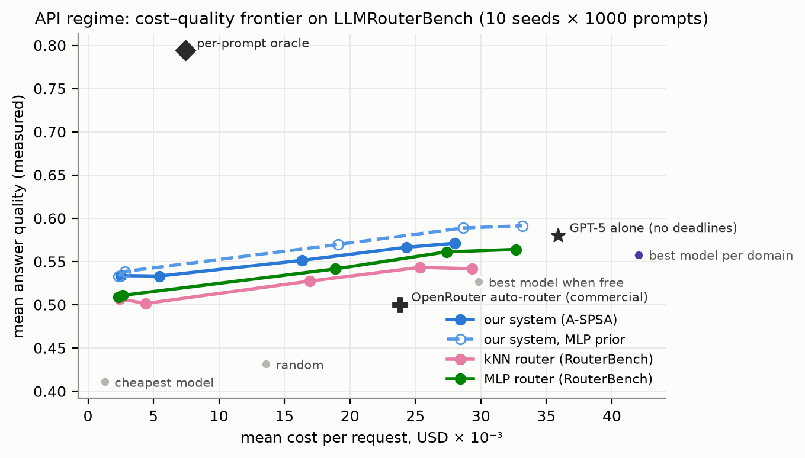

- **Что показано:** качество ответа и средняя цена запроса у каждой системы.
  API-режим, 10 seed × 1000 test-промптов.
- **Ось X:** средняя стоимость одного запроса, USD × 10⁻³. Левее — дешевле.
- **Ось Y:** среднее измеренное качество ответа (доля решённых задач). Выше —
  лучше.
- **Синяя сплошная линия** — наша система с kNN-приором, **синяя пунктирная с
  полыми маркерами** — с MLP-приором. Каждая точка — свой вес цены `π` из
  {0, 0.08, 0.3, 1, 3}: слева самый сильный штраф за цену, справа без штрафа.
- **Розовая линия** — kNN-роутер RouterBench, **зелёная** — MLP-роутер
  RouterBench, с тем же перебором `π`.
- **Серые точки** — бейзлайны с одной рабочей точкой; **фиолетовая** — лучшая
  модель по домену.
- **Чёрные маркеры:** крест — OpenRouter auto-router, звезда — GPT-5, ромб —
  per-prompt oracle.
- **Как читать:** чем выше и левее, тем лучше. Каждая наша линия лежит выше
  линии роутера с той же офлайн-оценкой: синяя сплошная — над розовой,
  пунктирная — над зелёной. Пунктирная линия проходит выше звезды GPT-5 при
  меньшей цене.

### 9.2 Система под нагрузкой

| | capacity: DHR | goodput/с | p95, с | stress: DHR | goodput/с | p95, с |
|---|---:|---:|---:|---:|---:|---:|
| **наша система (kNN-приор)** | **0.731** | **0.239** | 231 | 0.489 | 0.0747 | 1052 |
| **наша система, MLP-приор** | **0.756** | 0.236 | **208** | **0.502** | **0.0789** | **1021** |
| kNN-роутер | 0.684 | 0.209 | 307 | 0.420 | 0.0633 | 1282 |
| MLP-роутер | 0.696 | 0.212 | 302 | 0.422 | 0.0618 | 1386 |
| лучшая модель по домену | 0.678 | 0.209 | 301 | 0.445 | 0.0737 | 1191 |
| случайный выбор | 0.699 | 0.176 | 260 | 0.404 | 0.0454 | 1112 |
| per-prompt oracle | 0.919 | 0.554 | 107 | 0.725 | 0.1734 | 390 |

Парные сравнения, после Холма, 10 seed:

| Сравнение | capacity: DHR | capacity: p95 | stress: DHR | stress: p95 |
|---|---|---|---|---|
| kNN-приор против kNN-роутера | **+4.7 п.п.** (9/10, 0.031) | **−77 с** (10/10, 0.020) | **+6.9 п.п.** (9/10, 0.020) | **−230 с** (9/10, 0.035) |
| MLP-приор против MLP-роутера | **+6.0 п.п.** (9/10, 0.008) | **−94 с** (10/10, 0.006) | **+8.0 п.п.** (10/10, 0.006) | **−365 с** (10/10, 0.006) |
| kNN-приор против лучшей модели по домену | **+5.3 п.п.** (10/10, 0.020) | **−70 с** (10/10, 0.020) | **+4.5 п.п.** (9/10, 0.020) | — |

- Качество ответов у нашей системы и у роутеров одинаковое (разница
  незначима). Цена на 14–17 % ниже, чем у MLP-роутера (10/10, p_holm ≤ 0.006),
  и на 9–12 % ниже, чем у kNN-роутера.
- Все системы работают через один и тот же буфер со взвешенным приоритетом и
  ручными весами. Разница — в оценке пары: наша система учитывает прогноз
  времени обработки и дообучает прогнозы качества и времени на потоке. Если
  порядок очереди задаёт EDF, доля дедлайнов у всех систем выравнивается
  (раздел 9.2.1).

#### Рисунок 6. Архитектура под нагрузкой

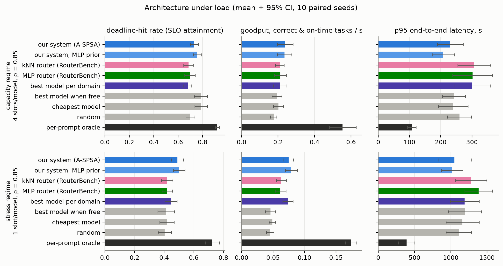

- **Что показано:** операционные метрики систем в двух режимах с очередью,
  среднее по 10 парным seed.
- **Строки:** верхняя — capacity (4 слота на модель, ρ = 0.85); нижняя —
  stress (1 слот на модель, ρ = 0.85).
- **Столбцы:**
  1. доля задач, выполненных до дедлайна, больше — лучше;
  2. goodput — правильные **и** своевременные задачи в секунду, больше —
     лучше;
  3. p95 latency — время от поступления до завершения, которое не превышают
     95 % задач, в секундах; меньше — лучше.
- **Полоса** — среднее, **чёрный отрезок** — 95 % доверительный интервал.
- **Цвета:** синий — наша система (светло-синий — с MLP-приором), розовый —
  kNN-роутер, зелёный — MLP-роутер, фиолетовый — лучшая модель по домену,
  серые — прочие бейзлайны, чёрный — oracle.
- **Как читать:**
  - Наша система чаще укладывается в дедлайн и имеет заметно более короткий
    хвост latency, чем роутер с той же офлайн-оценкой качества. Буфер у всех
    одинаковый. Выигрыш даёт оценка пары, которая учитывает прогноз времени и
    дообучается на потоке.
  - «Самая дешёвая» и «лучшая, когда свободна» в capacity укладываются в
    дедлайн чаще (0.78–0.79). Но их goodput ниже, чем у нашей системы (0.19–0.20
    против 0.24): они посылают задачи на быстрые, но слабые модели.

#### 9.2.1 Порядок очереди: взвешенный приоритет и классические правила

Та же система (A-SPSA, h = 0.01); меняется только порядок, в котором буфер
обслуживает ожидающие задачи (раздел 5.1). 10 парных seed.

| capacity | DHR | качество | goodput/с | p95, с |
|---|---:|---:|---:|---:|
| взвешенный приоритет, ручные веса | 0.743 | **0.470** | 0.232 | 221 |
| EDF | **0.926** | 0.461 | 0.238 | 176 |
| least slack first | 0.898 | 0.457 | 0.225 | 191 |
| SJF | 0.810 | 0.450 | **0.247** | **128** |

| stress | DHR | качество | goodput/с | p95, с |
|---|---:|---:|---:|---:|
| взвешенный приоритет, ручные веса | 0.495 | **0.457** | **0.0756** | 1062 |
| EDF | 0.564 | 0.440 | 0.0679 | 478 |
| least slack first | 0.412 | 0.433 | 0.0461 | 561 |
| SJF | **0.607** | 0.437 | 0.0693 | **317** |

- **По дедлайнам и хвосту latency** EDF и SJF значительно лучше взвешенного
  приоритета с ручными весами. В capacity EDF даёт +18 п.п. DHR (10/10,
  p_holm = 0.006), в stress SJF — +11 п.п. (9/10, p_holm = 0.012).
- **Взвешенный приоритет сохраняет качество** (+0.009…+0.024) при goodput на
  уровне EDF: 0.232 против 0.238 в capacity и 0.0756 против 0.0679 в stress,
  различия незначимы.
- **Вывод.** Ручные веса обменивают дедлайны на качество. Если цель — доля
  дедлайнов, точка отсчёта — EDF. Поэтому семейство приоритетов на слое
  политики включает срочность по дедлайну (раздел 4.2), и A-SPSA настраивает
  его именно на эту цель (раздел 9.3).

**Все системы на EDF-буфере.** Тот же EDF для всех, 10 парных seed:

| | capacity: DHR | p95, с | качество | stress: DHR | p95, с |
|---|---:|---:|---:|---:|---:|
| наша система | 0.926 | **176** | 0.461 | 0.564 | 478 |
| kNN-роутер | 0.931 | 192 | 0.456 | 0.557 | 483 |
| MLP-роутер | 0.922 | 192 | 0.462 | 0.548 | 455 |
| лучшая модель по домену | 0.913 | 192 | 0.448 | 0.523 | 452 |

- С EDF все системы достигают доли дедлайнов 0.91–0.93 (capacity) и
  0.52–0.56 (stress). Различия между ними незначимы.
- У нашей системы остаются короче p95 в capacity: −16 с против kNN (10/10,
  p_holm = 0.006). Против лучшей модели по домену качество выше на 0.014
  (9/10), а цена ниже на 11 %.
- **Итог для режимов с очередью: порядок очереди важнее маршрутизации.**
  - Выигрыш нашей системы по дедлайнам (раздел 9.2) проявляется при
    взвешенном приоритете. Он упорядочивает очередь по качеству, и учёт
    времени в оценке пары частично компенсирует это.
  - С EDF дедлайны обеспечивает сам порядок очереди, и выбор роутера на них
    почти не влияет.

### 9.3 A-SPSA на политике планировщика

**Шаг манускрипта** (h = 0.2 у всех), шесть весов, старт — ручные веса с
`λ_E = 0`. Held-out доля дедлайнов на тех же 5 test-потоках × 5 площадок,
9 seed оптимизатора:

| Политика | Малошумный оракул | min – max | Обычный оракул |
|---|---:|---|---:|
| **A-SPSA** | **0.919** | 0.908 – 0.925 | **0.915** |
| EDF (классическое правило, без настройки) | 0.913 | — | 0.913 |
| least slack first | 0.911 | — | 0.911 |
| ZO-GT | 0.909 | 0.907 – 0.915 | 0.907 |
| SPSA | 0.907 | 0.905 – 0.911 | 0.906 |
| ZO-PGD | 0.905 | 0.901 – 0.909 | 0.906 |
| ручные веса манускрипта | 0.861 | — | 0.861 |
| SJF | 0.815 | — | 0.815 |

- **A-SPSA — единственный метод, чья политика лучше лучшего классического
  правила.**
  - Малошумный оракул: выше EDF на 8/9 seed (p = 0.020) и выше LLF на 8/9
    (p = 0.012).
  - Против SPSA, ZO-GT и ZO-PGD: **+0.9…+1.4 п.п., 9/9 seed, p_holm =
    0.012**.
- **Обычный оракул.** A-SPSA снова лучший (0.915 против 0.906–0.907, 7–8/9
  seed), но по доле дедлайнов разница в пределах шума (p_holm = 0.082). По
  goodput A-SPSA лучше SPSA и ZO-GT: +0.20…+0.25, 8–9/9, p_holm ≤ 0.016.
- **Старт.** Все методы начинают с политики манускрипта (0.861) и сами
  находят срочность по дедлайну. Методы без ускорения при затухающем шаге
  останавливаются чуть ниже EDF, A-SPSA уходит дальше (рис. 11).

**Цена подбора шага.** Каждому методу шаг выбирается на validation из общей
сетки `{0.2, 0.5, 1, 2, 4, 8, 16}`, затем те же 9 test-seed (малошумный
оракул):

| Метод | Лучший шаг | Доля дедлайнов, test | min – max по seed |
|---|---:|---:|---|
| SPSA | 16 | 0.924 | 0.919 – 0.927 |
| **A-SPSA** | **1** | **0.923** | 0.912 – 0.927 |
| ZO-PGD | 16 | 0.922 | 0.916 – 0.927 |
| ZO-GT | 16 | 0.921 | 0.916 – 0.926 |
| A-SPSA без подбора (h = 0.2) | — | 0.919 | 0.908 – 0.925 |
| EDF | — | 0.913 | — |

- **С подобранным шагом все методы равны:** 0.921–0.924, различия незначимы
  (p = 0.34–0.74). Все они выше EDF.
- **Без подбора A-SPSA уже даёт 0.919** — выше EDF и в пределах 0.2–0.5 п.п.
  от подобранных методов. Значимо это отставание только против SPSA с шагом
  16 (p = 0.008).
- **Конкурентам нужен шаг 16**, в 80 раз больше предписанного. A-SPSA
  достигает лучшего результата при h = 1, внутри границы теории.
- **Цена подбора.** Сетка из 7 шагов на 2 seed стоит 4 200 вызовов оракула
  сверх 300 на сам прогон. Уровень выше EDF A-SPSA получает за 300 вызовов,
  остальные методы — только после подбора, **в ~15 раз дороже** (рис. 13).
- **Обычный оракул.** A-SPSA без подбора даёт 0.915 (выше EDF). После подбора:
  ZO-GT (h = 4) — 0.923, SPSA (16) — 0.922, ZO-PGD (2) — 0.918, A-SPSA (2) —
  0.917. Методы без ускорения с подобранным шагом здесь немного выше A-SPSA:
  +0.6 п.п. у ZO-GT, 7/9 seed, после поправки Холма незначимо. При шумном
  оракуле ускорение не даёт выигрыша (раздел 9.4), и остаётся только разница
  в цене подбора.

#### Рисунок 13. Доля дедлайнов при заданном бюджете вызовов оракула

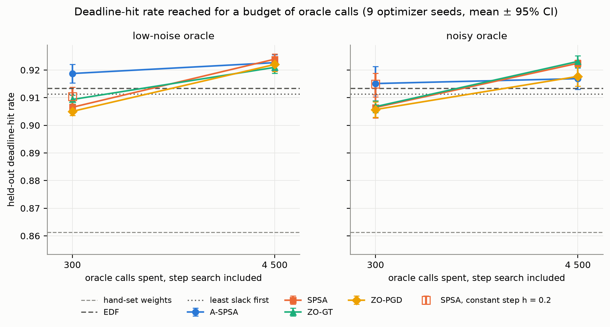

- **Что показано:** какой held-out доли дедлайнов достигает каждый метод при
  данном числе вызовов оракула, включая подбор шага. Шесть весов, 9 seed
  оптимизатора.
- **Ось X:** число вызовов оракула, логарифмическая шкала.
  - 300 — один прогон с шагом манускрипта без подбора.
  - 4 500 — подбор шага по сетке из 7 значений на 2 seed плюс итоговый
    прогон. Оценки на validation не учитываются, что в пользу методов,
    которым подбор нужен.
- **Ось Y:** доля задач, выполненных до дедлайна, на test-потоках.
- **Маркеры:** цвета методов как на остальных рисунках; **полый квадрат** —
  SPSA с постоянным шагом h = 0.2, то есть A-SPSA без ускорения; отрезки —
  95 % доверительный интервал.
- **Горизонтали:** EDF (штрих), least slack first (точки), ручные веса
  (светлый штрих).
- **Панели:** слева малошумный оракул, справа обычный.
- **Как читать:**
  - При бюджете одного прогона выше линии EDF только A-SPSA. Остальным
    методам нужен подбор шага, то есть примерно в 15 раз больше вызовов.
  - С подбором все методы сходятся к 0.92, а при обычном оракуле подобранные
    ZO-GT и SPSA оказываются немного выше.

**Роль шума оракула.** Выигрыш A-SPSA значим при малошумном оракуле (9/9
seed) и остаётся тенденцией при обычном (7–8/9). Это согласуется с теорией
ускорения: ускоренная схема накапливает не только сигнал, но и шум оценки, и
выигрывает сильнее, когда шум подавлен.

#### Рисунок 1. Динамика оптимизируемого функционала по раундам

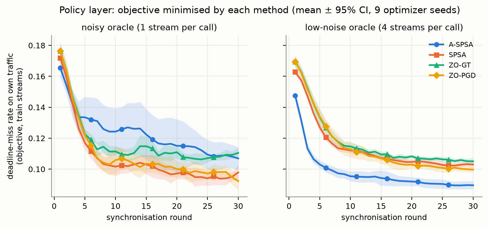

| | A-SPSA | SPSA | ZO-GT | ZO-PGD |
|---|---:|---:|---:|---:|
| функционал на 1-м раунде, малошумный | 0.148 | 0.163 | 0.170 | 0.170 |
| функционал, среднее последних 5 раундов, малошумный | **0.090** | 0.103 | 0.106 | 0.100 |
| функционал, среднее последних 5 раундов, обычный | 0.108 | 0.095 | 0.109 | 0.096 |

- **Что показано:** значение целевого функционала площадок — доли срывов
  дедлайна на собственном трафике (`J = 1 − DHR`) — так, как его видит
  оптимизатор на каждом раунде. Среднее по 5 площадкам и 9 seed; для раунда
  берётся среднее двух пробных вычислений оракула, кривая сглажена окном в
  3 раунда.
- **Ось X:** номер раунда синхронизации (1–30). Каждый раунд — два вызова
  оракула на площадку.
- **Ось Y:** доля задач, не уложившихся в дедлайн, на train-потоках площадки.
  Меньше — лучше.
- **Панели:** слева обычный оракул (один поток на вызов), справа малошумный
  (среднее по 4 потокам).
- **Полоса** — 95 % доверительный интервал по seed.
- **Как читать:**
  - Все методы стартуют с одних и тех же ручных весов.
  - **Малошумный оракул (справа).** A-SPSA опускает функционал быстрее и
    глубже. Уровень, которого лучший из конкурентов достигает к 30-му раунду
    (0.100), A-SPSA достигает **к 7-му раунду**, то есть примерно **вчетверо
    меньшим числом вызовов оракула**. Итоговое значение ниже каждого
    конкурента на 9/9 seed (p = 0.004).
  - **Обычный оракул (слева).** Кривая A-SPSA до ~25-го раунда выше
    остальных. A-SPSA вычисляет оракул не в самой итерации θ, а в
    экстраполированной пробной точке θ̃ (раздел 4.3). При шуме одного потока
    эти пробы обходятся дороже, поэтому кривая показывает функционал «глазами
    оптимизатора», а не качество найденных весов. Сами найденные веса у
    A-SPSA лучше и на test: 0.915 против 0.906–0.907 (рис. 7).

#### Рисунок 7. Выигрыш от снижения шума и сравнение по seed

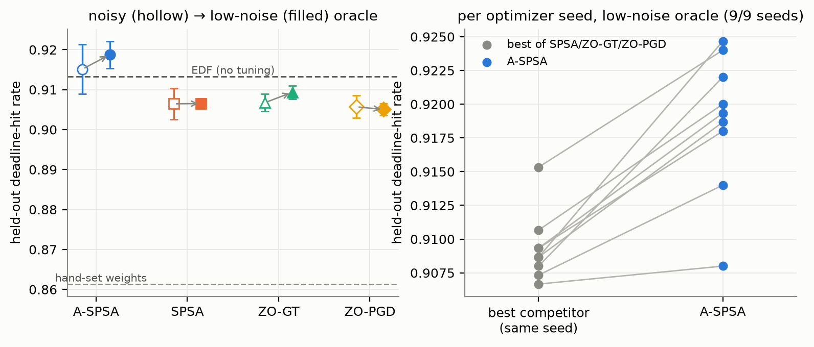

- **Левая панель:** held-out доля дедлайнов каждого метода в двух условиях
  оракула.
  - **Ось X:** метод; **ось Y:** доля задач, выполненных до дедлайна.
  - **Полый маркер** — обычный оракул, **закрашенный** — малошумный,
    **стрелка** — сдвиг от снижения шума, **отрезки** — 95 % доверительный
    интервал по 9 seed.
  - **Пунктиры:** нижний — ручные веса манускрипта, верхний — EDF без
    настройки.
  - **Как читать:** A-SPSA лучше всех в обоих условиях, и только его точки
    лежат выше линии EDF.
- **Правая панель:** каждая линия — один seed оптимизатора, малошумный оракул.
  - **Левая точка** — лучший из SPSA / ZO-GT / ZO-PGD на этом seed, **правая** —
    A-SPSA на том же seed. Ось Y та же.
  - **Как читать:** все 9 линий идут вверх. На каждом seed A-SPSA находит
    политику лучше, чем лучший из трёх других методов.

#### Рисунок 8. Устойчивость к выбору шага

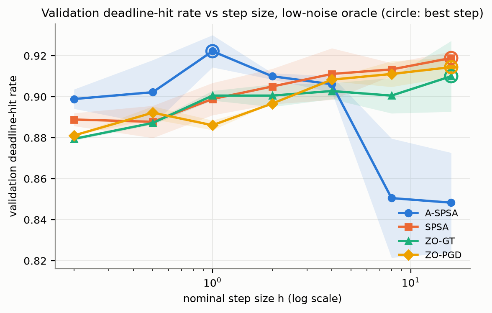

- **Что показано:** доля дедлайнов на validation в зависимости от
  номинального шага h, для каждого метода, малошумный оракул. Среднее по
  2 seed оптимизатора × 3 validation-потока.
- **Ось X:** шаг h, логарифмическая шкала, от 0.2 (шаг манускрипта) до 16.
- **Ось Y:** доля задач, выполненных до дедлайна, на validation.
- **Полоса** — ± стандартное отклонение по seed; **кружок** — лучший шаг
  метода, с ним проводится test.
- **Как читать:**
  - В диапазоне h от 0.2 до 2 A-SPSA заметно лучше конкурентов. Его лучший
    результат — 0.922 при h = 1.
  - SPSA, ZO-GT и ZO-PGD достигают сопоставимого уровня (0.910–0.919) только
    при шаге 16, на краю сетки. Их шаг затухает как `h/(k+10)^0.602`, поэтому
    им нужен очень большой номинальный шаг.
  - При h ≥ 8 A-SPSA теряет устойчивость (0.85). Это выше границы теории
    `h ≤ 1/(ω λ_max) = 2.76` (раздел 4.4), и лучший шаг h = 1 лежит внутри
    неё.

### 9.4 За счёт чего выигрывает A-SPSA

**Абляция** (шаг манускрипта h = 0.2, 9 seed, всё остальное идентично):

| Вариант | Малошумный | Обычный | против полного A-SPSA (малошумный) |
|---|---:|---:|---|
| **A-SPSA, полный** | **0.919** | 0.915 | — |
| A-SPSA, нормированная пробная точка | 0.919 | **0.917** | разницы нет |
| A-SPSA без консенсуса | **0.923** | 0.913 | +0.4 п.п., незначимо |
| A-SPSA без ускорения (= SPSA с постоянным шагом) | 0.910 | 0.915 | −0.8 п.п., 8/9 seed, p_holm = 0.059 |
| SPSA / ZO-GT / ZO-PGD (затухающий шаг) | 0.905–0.909 | 0.906–0.907 | −0.9…−1.4 п.п., 9/9 seed, p_holm = 0.023 |
| EDF | 0.913 | 0.913 | — |
| ручные веса | 0.861 | 0.861 | — |

- **Из чего складывается выигрыш над SPSA** при малошумном оракуле
  (+1.2 п.п.):
  - постоянный шаг вместо затухающего даёт около трети (SPSA с постоянным
    шагом — 0.910 против 0.907);
  - ускорение даёт около двух третей: +0.8 п.п. к постоянному шагу, 8/9
    seed. После поправки на три варианта абляции это на грани значимости,
    p_holm = 0.059.
- **При обычном оракуле** ускорение не добавляет ничего (0.915 против 0.915).
  Весь выигрыш даёт постоянный шаг, как и предсказывает теория: при сильном
  шуме ускоренная схема накапливает шум вместе с сигналом.
- **Консенсус** на этой задаче не помогает. Вероятная причина: площадки
  обслуживают разные домены, и согласование их весов мало что даёт.
- **Нормированная пробная точка** даёт тот же результат.

#### Рисунок 9. Абляция A-SPSA

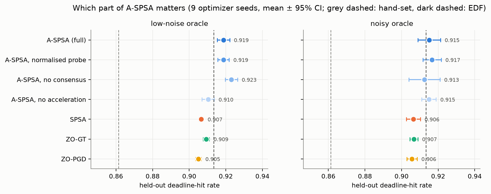

- **Что показано:** held-out доля дедлайнов полного A-SPSA, его трёх вариантов
  и конкурентов. 9 seed оптимизатора.
- **Ось X:** доля задач, выполненных до дедлайна. Шкала начинается не с нуля,
  поэтому показаны точки, а не столбцы.
- **Ось Y:** вариант метода.
- **Точка** — среднее (значение подписано), **отрезок** — 95 % доверительный
  интервал. **Серый пунктир** — ручные веса, **тёмный пунктир** — EDF.
- **Панели:** слева малошумный оракул, справа обычный.
- **Как читать:**
  - При малошумном оракуле варианты A-SPSA с ускорением лежат правее линии
    EDF. Без ускорения A-SPSA сдвигается к методам без ускорения.
  - При обычном оракуле все варианты A-SPSA около EDF, а методы с затухающим
    шагом левее.

#### Рисунок 11. Какие веса находит каждый метод

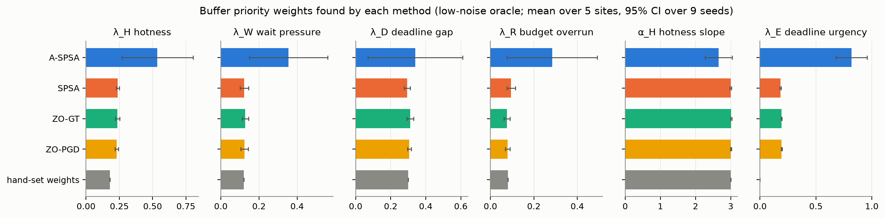

- **Что показано:** итоговые веса буфера (раздел 2.5), найденные каждым
  методом при малошумном оракуле. Среднее по 5 площадкам и 9 seed.
- **Панели:** шесть весов — горячесть задачи λ_H, давление ожидания λ_W,
  штраф за просрочку λ_D, штраф за превышение бюджета λ_R, крутизна горячести
  α_H и срочность по дедлайну λ_E.
- **Ось X:** значение веса; **полоска** — среднее, **отрезок** — 95 %
  доверительный интервал.
- **Как читать:**
  - Все методы включают срочность по дедлайну, которой у ручных весов нет
    (λ_E = 0). SPSA, ZO-GT и ZO-PGD поднимают её до 0.18–0.19 и почти не
    трогают остальные веса.
  - A-SPSA поднимает срочность до **0.82** и одновременно:
    - вес горячести λ_H 0.18 → **0.54**;
    - давление ожидания λ_W 0.12 → 0.36;
    - штраф за превышение бюджета λ_R 0.08 → **0.28**.
  - Получается политика «ранний дедлайн первым, но без задач, которые уже не
    успевают». Её нет среди классических правил, и она обходит EDF
    (раздел 9.3).

### 9.5 Поведение под нагрузкой с весами от оптимизаторов

#### Рисунок 2. Загрузка агентов и дедлайны по эпохам

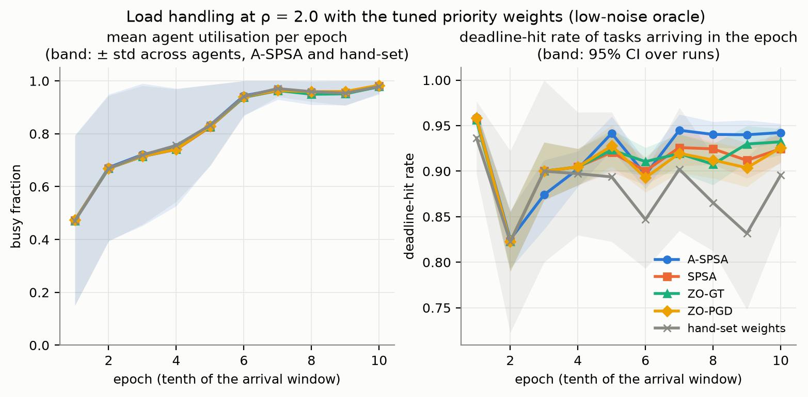

| Эпоха | 6 | 7 | 8 | 9 | 10 |
|---|---:|---:|---:|---:|---:|
| загрузка агентов (все методы) | 0.94 | 0.96–0.97 | 0.95–0.96 | 0.95–0.96 | 0.98 |
| доля дедлайнов, **A-SPSA** | 0.896 | **0.945** | **0.940** | **0.940** | **0.942** |
| доля дедлайнов, SPSA / ZO-GT / ZO-PGD | 0.893–0.911 | 0.919–0.926 | 0.908–0.924 | 0.904–0.930 | 0.925–0.932 |
| доля дедлайнов, ручные веса | 0.847 | 0.902 | 0.865 | 0.832 | 0.896 |

- **Что показано:** как система переносит растущую нагрузку в ходе прогона.
  Веса каждого метода после оптимизации (малошумный оракул), ρ = 2.0,
  5 площадок × 5 test-потоков × 9 seed.
- **Ось X (обе панели):** эпоха — одна десятая окна поступления задач. В
  эпохе 1 поток только начинается, к последним эпохам накопленная очередь
  максимальна.
- **Левая панель, ось Y:** средняя загрузка агента в эпохе — доля времени,
  когда слот модели занят (0 — простаивает, 1 — занят всё время). **Полоса** —
  ± стандартное отклонение загрузки по агентам (для A-SPSA и ручных весов),
  то есть насколько равномерно распределена работа.
- **Правая панель, ось Y:** доля задач, **поступивших** в эпоху, которые
  выполнены до дедлайна. **Полоса** — 95 % доверительный интервал.
- **Как читать:**
  - С 6-й эпохи агенты загружены на 94–98 %, система работает в насыщении, и
    работа распределена по агентам одинаково равномерно у всех методов.
    Выигрыш даёт порядок обслуживания, а не загрузка.
  - В перегруженных эпохах 7–10 A-SPSA удерживает дедлайны на **1–2 п.п.
    лучше** лучшего из остальных методов и на **4–11 п.п. лучше** ручных весов.

#### Рисунок 3. Накопленное число задач, выполненных в срок

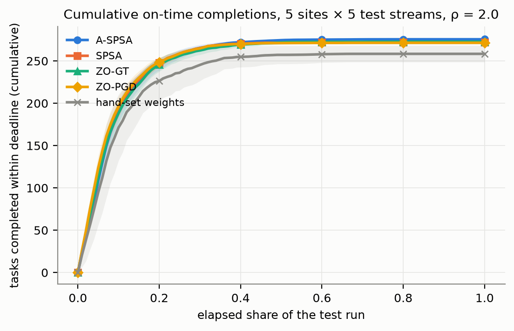

- **Что показано:** сколько задач выполнено до дедлайна к каждому моменту
  тестового прогона. Сумма по 5 площадкам одного test-потока, среднее по
  9 seed × 5 потоков, ρ = 2.0.
- **Ось X:** прошедшая доля тестового прогона, от первого поступления (0) до
  последнего завершения (1).
- **Ось Y:** накопленное число задач, завершённых до своего дедлайна.
- **Полоса** — 95 % доверительный интервал.
- **Как читать:** кривые настроенных политик отрываются от ручных весов уже на
  первой пятой прогона, на пике нагрузки. На плато A-SPSA выходит на **275.6
  задачи** против 271.5–272.8 у остальных методов и 258.4 у ручных весов, то
  есть **+3–4 задачи в срок** на каждом потоке против других методов и **+17**
  против ручных весов.

#### Рисунок 4. Устойчивость к нагрузке

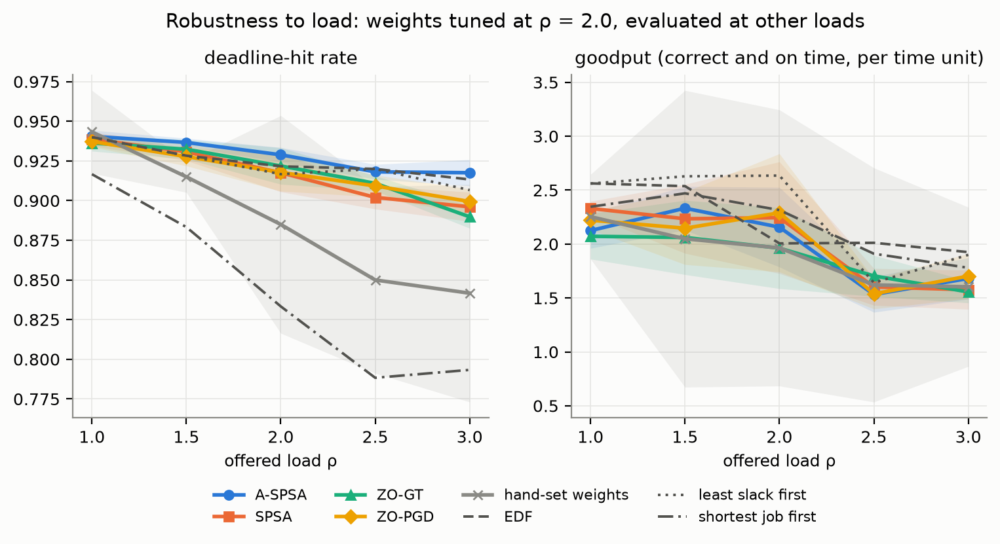

| ρ | A-SPSA | SPSA | ZO-GT | ZO-PGD | EDF | LLF | SJF | ручные веса |
|---:|---:|---:|---:|---:|---:|---:|---:|---:|
| 1.0 | 0.941 | 0.939 | 0.936 | 0.937 | 0.940 | 0.940 | 0.917 | 0.943 |
| 1.5 | **0.937** | 0.931 | 0.932 | 0.928 | 0.928 | 0.928 | 0.883 | 0.915 |
| 2.0 | **0.929** | 0.918 | 0.922 | 0.918 | 0.922 | 0.917 | 0.833 | 0.885 |
| 2.5 | 0.918 | 0.902 | 0.911 | 0.909 | **0.920** | **0.920** | 0.788 | 0.850 |
| 3.0 | **0.918** | 0.896 | 0.890 | 0.899 | 0.913 | 0.907 | 0.793 | 0.842 |

- **Что показано:** веса, найденные каждым методом при ρ = 2.0, проверяются при
  других нагрузках (от 1.0 до 3.0). 9 seed × 2 test-потока × 5 площадок.
- **Ось X:** предлагаемая нагрузка ρ (1.0 — пул справляется с потоком; 3.0 —
  поток в три раза выше номинальной ёмкости).
- **Левая панель, ось Y:** доля задач, выполненных до дедлайна.
- **Правая панель, ось Y:** goodput — правильные и своевременные задачи в
  единицу времени (единица = 30 с).
- **Линии:** цветные — веса методов (полоса — 95 % доверительный интервал),
  серая с крестами — ручные веса, тёмные штриховые — классические правила
  (EDF, least slack first, SJF).
- **Как читать:**
  - При ρ = 1 все политики одинаковы: ставить в очередь нечего.
  - С ростом нагрузки отрыв A-SPSA от других методов нулевого порядка растёт:
    при ρ = 3 он составляет **+1.8…+2.8 п.п.**
  - EDF и A-SPSA идут вровень во всём диапазоне (±1 п.п.; при ρ = 2.5 EDF на
    0.2 п.п. выше).
  - Ручные веса манускрипта и SJF с ростом нагрузки сильно теряют.
  - Найденные при ρ = 2.0 веса переносятся на нагрузки, при которых их не
    настраивали.
  - По goodput (правая панель) при ρ ≤ 2 классические правила не хуже
    настроенных политик: оптимизировалась доля дедлайнов, а не goodput.

### 9.6 Слой предикторов: A-SPSA при равном шаге

**Постановка.** Три метода синхронизируют предикторы контроллеров по
функционалам Φ_p, Φ_w, Φ_q (раздел 4.1) с одним и тем же шагом `h` на всех
блоках. A-SPSA держит шаг постоянным, SPSA и ZO-GT используют стандартное
затухание, как на слое политики. RLS, сила приора, seed и поток задач у всех
одинаковы; 10 парных test-seed × 1000 задач в каждом режиме.

**Результат** (меньше — лучше; Δ — A-SPSA против SPSA / ZO-GT):

| Режим | h | F1: A-SPSA | SPSA | ZO-GT | Δ F1 | Δ MAPE времени | Δ Φ_p |
|---|---:|---:|---:|---:|---|---|---|
| API | 0.001 | **0.803** | 1.111 | 1.104 | −28 / −27 % | −16 / −16 % | −27 / −27 % |
| API | 0.01 | **0.610** | 1.066 | 1.065 | **−43 / −43 %** | −19 / −19 % | −33 / −33 % |
| capacity | 0.001 | **1.190** | 1.480 | 1.453 | −20 / −18 % | −20 / −21 % | −24 / −23 % |
| capacity | 0.01 | **0.741** | 1.421 | 1.398 | **−48 / −47 %** | −32 / −33 % | −39 / −38 % |
| stress | 0.001 | **1.150** | 1.334 | 1.304 | −14 / −12 % | −24 / −24 % | −19 / −18 % |
| stress | 0.01 | **0.903** | 1.283 | 1.309 | **−30 / −31 %** | −32 / −33 % | −33 / −34 % |

- **Все 36 сравнений значимы после поправки Холма:** p_holm = 0.0117, для
  MAPE в API при h = 0.01 — 0.023. A-SPSA ниже на 10/10 seed, в четырёх
  сравнениях — на 9/10.
- **Три метрики согласованы.** Выигрыш A-SPSA виден во всех трёх:
  - F1 — ошибка прогноза на выбранных парах в момент назначения;
  - MAPE — на всех парах test-потока, включая невыбранные;
  - Φ_p — сетевой функционал на окне наблюдений.
- **Против одного RLS** (F1: 1.116 в API, 1.495 в capacity, 1.330 в stress)
  A-SPSA при h = 0.01 снижает F1 на 45 / 50 / 32 %, MAPE на 20 / 32 / 33 %,
  Φ_p на 36 / 41 / 35 %; 10/10 seed (MAPE в API 9/10), p_holm = 0.018.
- **SPSA и ZO-GT при том же номинальном шаге почти не отходят от RLS:** их
  фактический шаг `h/(k+10)^0.602` в 4–17 раз меньше номинального. Та же
  картина, что на слое политики (раздел 9.3).

#### Рисунок 1b. Динамика функционала Φ_p по раундам

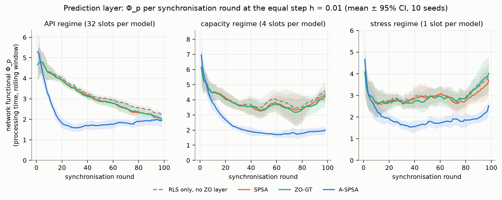

- **Что показано:** сетевой функционал времени обработки Φ_p (раздел 4.1)
  после каждого раунда синхронизации при общем шаге h = 0.01, среднее по
  10 seed. Это второй функционал, который оптимизирует A-SPSA; первый —
  функционал политики (рис. 1).
- **Ось X:** номер раунда синхронизации. Раунд — каждые 10 завершённых задач
  после разогрева в 30 задач: 98 раундов на поток из 1000 задач.
- **Ось Y:** `Φ_p = Σ_j F1_j(θ_j) + (ω/4) Σ_j Σ_l b_jl ‖θ_j − θ_l‖²`, где
  `F1_j` — функционал F1 контроллера j на его скользящем окне наблюдений.
  Меньше — лучше.
- **Панели:** режимы API (32 слота на модель), capacity (4 слота), stress
  (1 слот).
- **Линии:** синяя — A-SPSA, оранжевая — SPSA, зелёная — ZO-GT, серый
  пунктир — один RLS без слоя нулевого порядка. **Полоса** — 95 %
  доверительный интервал по seed.
- **Как читать:**
  - Все методы стартуют с одного офлайн-профиля. На первом раунде Φ_p у
    A-SPSA чуть выше: первая пробная точка ускоренной схемы отходит от
    стартовых параметров.
  - К 3-му (stress), 9-му (capacity) и 17-му (API) раунду A-SPSA опускается
    ниже уровня, которого конкуренты достигают только к концу потока, и
    держится там.
  - Итог за последние 10 раундов: capacity **1.93 против 3.93–4.26** (−51 %,
    10/10 seed), stress **2.13 против 3.36–3.71** (−37 %, 9–10/10 seed).
  - В API конкуренты к концу потока подтягиваются (1.95 против 2.12–2.33), но
    в среднем по раундам Φ_p у A-SPSA на 33 % ниже.
  - SPSA и ZO-GT почти повторяют кривую одного RLS.

#### Рисунок 12. F1 при равном шаге

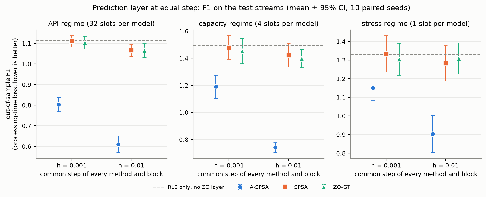

- **Что показано:** out-of-sample F1 каждого метода при общем шаге
  h ∈ {0.001, 0.01}, три режима, 10 парных seed.
- **Ось X:** общий шаг h всех методов и всех трёх блоков.
- **Ось Y:** out-of-sample F1 — среднее по задачам test-потока значение
  функционала F1 (раздел 4.1) на прогнозе времени `p̂`, сделанном до исполнения
  задачи, против фактического времени. Меньше — лучше. У каждой панели своя
  шкала.
- **Маркеры:** круг — A-SPSA, квадрат — SPSA, треугольник — ZO-GT; точка —
  среднее, отрезок — 95 % доверительный интервал. **Серый пунктир** — один
  RLS без слоя нулевого порядка.
- **Как читать:** при обоих шагах во всех режимах A-SPSA заметно ниже
  конкурентов, и разрыв растёт с шагом. При h = 0.01 F1 у A-SPSA на 30–48 %
  ниже, чем у SPSA и ZO-GT, и на 32–50 % ниже, чем у одного RLS. SPSA и ZO-GT
  остаются у уровня RLS.

### 9.7 Второй бенчмарк: SPROUT без подбора

Конфигурация перенесена с LLMRouterBench без изменений: h = 0.01 на всех
блоках, те же веса оценки и буфера. На validation SPROUT выбирается только
общая сила приора RLS. 10 парных seed × 1000 задач.

**API-режим** (π = 0.08):

| Система | Качество | $/запрос | AIQ |
|---|---:|---:|---:|
| per-prompt oracle | 0.976 | 0.0008 | — |
| лучшая модель по домену | 0.854 | 0.0037 | — |
| **наша система, MLP-приор** | **0.829** | 0.0013 | **0.808** |
| GPT-4o одной моделью | 0.829 | 0.0077 | — |
| MLP-роутер | 0.823 | 0.0014 | 0.805 |
| **наша система (kNN-приор)** | 0.818 | 0.0014 | 0.799 |
| kNN-роутер | 0.817 | 0.0013 | 0.795 |

**Под нагрузкой** (π = 0.08):

| Система | capacity: DHR | качество | stress: DHR | качество | stress: goodput/с |
|---|---:|---:|---:|---:|---:|
| **наша система, MLP-приор** | 0.708 | 0.722 | **0.456** | 0.705 | **0.572** |
| **наша система (kNN-приор)** | 0.700 | **0.724** | 0.424 | 0.701 | 0.538 |
| MLP-роутер | 0.699 | 0.716 | 0.431 | 0.702 | 0.532 |
| kNN-роутер | 0.691 | 0.710 | 0.428 | 0.699 | 0.490 |
| лучшая модель по домену | 0.708 | 0.708 | 0.424 | 0.688 | 0.462 |
| лучшая модель, когда свободна | 0.721 | 0.675 | 0.387 | 0.664 | 0.426 |

- **Качество ответа** выше, чем у бейзлайнов с той же офлайн-оценкой:
  - capacity: против kNN-роутера **+0.013**, против выбора по домену
    **+0.015** (9/10 seed, p = 0.004);
  - stress: против выбора по домену **+0.013** (8/10, p = 0.014), goodput
    **+0.076** (9/10, p = 0.004).
- **Качество GPT-4o** (0.829) система с MLP-приором даёт **в 6 раз дешевле**.
- **Доля дедлайнов** на уровне роутеров (±1 п.п., незначимо). Исключение —
  stress с MLP-приором: +2.5 п.п. против MLP-роутера (7/10, p = 0.027).
- **Граница применимости.** Все модели SPROUT отвечают за секунды, медианы
  2–10 с. Выигрыш по дедлайнам на LLMRouterBench появляется там, где время
  ответа моделей различается на порядки (reasoning-модели отвечают минутами).
  При однородных моделях учитывать время почти нечего, и остаётся выигрыш по
  качеству.

**Слой предикторов: повтор раздела 9.6.** A-SPSA против SPSA, ZO-GT и одного
RLS при общем шаге h = 0.01; различия — A-SPSA относительно каждого из трёх:

| Режим | F1: A-SPSA / остальные | Δ F1 | Δ MAPE времени | Δ Φ_p |
|---|---|---|---|---|
| API | 0.287 / 0.410–0.414 | −30…−31 % | −17…−18 % | −33…−34 % |
| capacity | 0.372 / 0.523–0.533 | −29…−30 % | −22 % | −30 % |
| stress | 0.432 / 0.577–0.592 | −25…−27 % | −23…−24 % | −34…−35 % |

- **Все 27 сравнений** (3 метрики × 3 режима × 3 соперника) значимы: 10/10
  seed, p_holm = 0.006.
- Выигрыш того же порядка, что на LLMRouterBench при том же шаге (F1
  −30…−48 %), и получен **без какого-либо подбора на новом бенчмарке**.
- SPSA и ZO-GT при этом шаге не отличаются от одного RLS: их затухающий шаг
  почти ничего не меняет.

### 9.8 Чувствительность к профилям задержки

Наша система (A-SPSA, h = 0.01, без подбора) против kNN-роутера и лучшей
модели по домену; варианты профилей — раздел 3.5; LLMRouterBench, π = 0.08,
10 парных seed.

| Профили | Режим | DHR: наша / kNN / по домену | против kNN | против по домену | p95, с: наша / kNN |
|---|---|---|---|---|---|
| по умолчанию | capacity | **0.743** / 0.684 / 0.678 | **+5.9 п.п.**, 10/10 | **+6.5 п.п.**, 10/10 | **221** / 307 |
| по умолчанию | stress | **0.495** / 0.420 / 0.445 | **+7.5 п.п.**, 10/10 | **+5.0 п.п.**, 9/10 | **1062** / 1282 |
| все в 2× медленнее | capacity | **0.796** / 0.673 / 0.652 | **+12.3 п.п.**, 10/10 | **+14.4 п.п.**, 10/10 | **323** / 623 |
| все в 2× медленнее | stress | **0.519** / 0.417 / 0.434 | **+10.2 п.п.**, 10/10 | **+8.4 п.п.**, 10/10 | **1670** / 2565 |
| все в 2× быстрее | capacity | 0.703 / 0.694 / 0.686 | +0.9 п.п., 7/10 | +1.7 п.п., 8/10 | **143** / 162 |
| все в 2× быстрее | stress | 0.456 / 0.437 / 0.455 | +1.9 п.п., 7/10 | +0.1 п.п., 5/10 | 625 / 682 |
| перестановка 1 | capacity | **0.768** / 0.720 / 0.678 | **+4.8 п.п.**, 8/10 | **+9.0 п.п.**, 10/10 | **208** / 301 |
| перестановка 1 | stress | **0.517** / 0.454 / 0.447 | **+6.3 п.п.**, 9/10 | **+7.0 п.п.**, 10/10 | **938** / 1253 |
| перестановка 2 | capacity | **0.732** / 0.707 / 0.694 | **+2.5 п.п.**, 10/10 | **+3.8 п.п.**, 9/10 | **240** / 316 |
| перестановка 2 | stress | **0.480** / 0.449 / 0.447 | +3.1 п.п., 8/10 | **+3.3 п.п.**, 8/10 | 1178 / 1286 |
| перестановка 3 | capacity | **0.751** / 0.681 / 0.671 | **+7.0 п.п.**, 10/10 | **+8.0 п.п.**, 10/10 | **230** / 350 |
| перестановка 3 | stress | **0.474** / 0.418 / 0.426 | **+5.6 п.п.**, 10/10 | **+4.8 п.п.**, 8/10 | **1334** / 1514 |

Жирным отмечены различия, значимые после поправки Холма (p_holm < 0.05).

- **В пяти вариантах из шести** наша система значимо чаще укладывается в
  дедлайн, чем оба бейзлайна, в обоих режимах. Исключение — stress в
  перестановке 2 против kNN: +3.1 п.п., p_holm = 0.065.
- **Выигрыш растёт с длительностью ответов.** Он наибольший, когда все модели
  медленнее (+10…+14 п.п.), и почти исчезает, когда все вдвое быстрее
  (+0.1…+1.9 п.п., незначимо). Это та же граница, что на SPROUT (раздел 9.7):
  маршрутизация с учётом времени выигрывает там, где ответы длинные и
  различаются по моделям.
- **Порядок моделей по скорости не важен.** Во всех трёх случайных
  перестановках скоростей моделей преимущество сохраняется. Значит, вывод не
  опирается на конкретные предположения о том, какая модель быстрая.

---

## 10. Что утверждает статья

1. **A-SPSA оптимизирует политику планировщика** — задачу без замкнутой формы
   и без градиента — лучше SPSA, ZO-GT и ZO-PGD на реальных исходах LLM при
   шаге манускрипта (9/9 seed при малошумном оракуле).
   - Стартуя с ручного приоритета манускрипта, он сам находит срочность по
     дедлайну и приходит к политике «ранний дедлайн первым, без заведомо
     опоздавших задач».
   - Это единственный метод, чья политика лучше лучшего классического правила
     EDF (0.919 против 0.913, 8/9 seed).
2. **Источник выигрыша — постоянный шаг и ускорение.** При малошумном оракуле
   около 2/3 выигрыша над SPSA даёт ускорение, около 1/3 — отказ от
   затухания шага. При обычном оракуле работает только постоянный шаг: как и
   предсказывает теория, ускорение выигрывает, когда шум оракула подавлен.
3. **A-SPSA сходится быстрее и не требует подбора шага.**
   - Итоговый уровень лучшего конкурента он достигает к 7-му раунду из 30 на
     политике и к 3–17-му раунду из 98 на слое предикторов.
   - На шаге манускрипта, за 300 вызовов оракула, его политика уже выше EDF.
     Остальным методам для этого нужен перебор шага, примерно в 15 раз
     больше вызовов.
   - С подобранным шагом все методы выравниваются, при шумном оракуле
     подобранные методы без ускорения даже немного выше (рис. 13).
4. **Найденная политика устойчива.** Веса, настроенные при ρ = 2, при
   нагрузках от 1 до 3 держатся на уровне EDF, а отрыв от методов без
   ускорения растёт с нагрузкой.
5. **Архитектура даёт значимый выигрыш над роутерами из литературы с той же
   офлайн-оценкой качества** (kNN и обученный MLP из RouterBench) и над
   коммерческим OpenRouter. Архитектура здесь — это оценка пары с прогнозом
   времени и дообучением на потоке плюс глобальный буфер.
   - В API-режиме: +0.023…+0.028 качества и +0.025 AIQ.
   - Под нагрузкой при взвешенном приоритете: +4.7…+8.0 п.п. дедлайнов и
     заметно более короткий хвост latency. С EDF-буфером доля дедлайнов у всех
     роутеров одинакова: порядок очереди важнее маршрутизации (раздел 9.2.1).
   - С MLP-приором система превосходит GPT-5 по качеству при цене на 20 %
     ниже.
6. **На слое предикторов при равном шаге A-SPSA обучает модель времени
   обработки значительно лучше SPSA и ZO-GT:** out-of-sample F1 ниже на
   12–48 %, held-out MAPE — на 16–33 %, сетевой функционал Φ_p — на 18–39 %.
   Так во всех трёх режимах нагрузки и при обоих шагах; все 36 сравнений
   значимы после поправки Холма. На втором бенчмарке (SPROUT) результат
   повторяется без какого-либо подбора: F1 −25…−31 %, 27/27 сравнений,
   10/10 seed.
7. **Двухуровневое обучение** (RLS после каждого исхода, синхронизация A-SPSA
   раз в 10 исходов) снижает ошибку прогноза времени относительно одного RLS
   на треть–половину: F1 −32…−50 %, 10/10 seed в каждом режиме.
8. **Под нагрузкой порядок очереди важнее маршрутизации.**
   - EDF поднимает долю дедлайнов с 0.743 до 0.926 по сравнению с ручным
     взвешенным приоритетом манускрипта. При EDF все роутеры сходятся к
     одному уровню.
   - Параметрическое семейство приоритетов, в которое EDF входит частным
     случаем, A-SPSA настраивает до политики лучше EDF (утверждение 1).

### 10.1 Ограничения

1. **Шаг.** Преимущество A-SPSA над SPSA, ZO-GT и ZO-PGD получено при
   одинаковом номинальном шаге; у методов без ускорения шаг затухает.
   - Если каждому методу подобрать шаг по сетке {0.2 … 16}, на политике
     результаты выравниваются (0.921–0.924, различия незначимы). Лучший шаг
     конкурентов лежит на краю сетки (16).
   - На слое предикторов SPSA и ZO-GT с шагами 0.5–1 дают F1 не хуже A-SPSA.

   Поэтому утверждение статьи — «A-SPSA не требует подбора шага» (рис. 13), а
   не «A-SPSA находит лучший оптимум».
2. **Слой предикторов.**
   - Выигрыш A-SPSA — в относительной точности прогноза времени (F1, MAPE).
     Абсолютная RMSE у всех методов одинакова: её определяет хвост
     многоминутных ответов.
   - Более точный прогноз не повышает долю дедлайнов: при h = 0.01 она у
     A-SPSA на 0.6–1.6 п.п. ниже.
   - По функционалам ожидания и качества (Φ_w, Φ_q) A-SPSA не лучше
     конкурентов.
   - При h ≥ 0.05 (в 20 раз выше границы теории) ускоренная схема теряет
     согласие контроллеров.
3. **Теория и политика.** Доля дедлайнов кусочно-постоянна по весам
   приоритета. Условия гладкости и сильной выпуклости теории на ней не
   выполняются, поэтому результаты на политике эмпирические.
4. **Задержка** смоделирована по измеренным токенам с оценочными профилями
   TTFT и скорости.
   - Выводы устойчивы к вариантам профилей (раздел 9.8), кроме случая, когда
     все модели быстрые: тогда выигрыша по дедлайнам нет.
   - Батчинг не моделируется: слот обслуживает одну задачу за раз.
5. **OpenRouter** выбирает из собственного пула моделей и работает без
   очереди. Это опорная точка, а не бейзлайн в равных условиях.
6. **Нагрузка.** На политике выигрыш появляется только при перегрузке
   (ρ ≥ 1.5); при ρ = 1 все политики равны. В API-режиме наша система с
   kNN-приором реже MLP-роутера укладывается в дедлайн (0.925 против 0.942):
   вес времени там равен нулю.
7. **Семейство приоритетов манускрипта.** В семействе из пяти весов
   манускрипта нет срочности по дедлайну. EDF (0.913) лучше любой политики,
   найденной в нём любым методом, даже с подбором шага (0.900–0.910). Поэтому
   добавлен шестой вес λ_E (раздел 2.5), и EDF стал частным случаем семейства.
   Ручной приоритет манускрипта в системе с очередью уступает EDF по доле
   дедлайнов 18 п.п., но держит качество выше (раздел 9.2.1).
8. **Однородные модели.** На SPROUT, где все модели отвечают за секунды,
   выигрыша по дедлайнам нет (±1 п.п.). Остаётся выигрыш по качеству
   (+0.013…+0.015), а в API-режиме он мал (+0.001…+0.007). Выбор лучшей модели
   по домену там даёт качество выше (0.854 против 0.829), но в 2.8 раза
   дороже.

---

## 11. Воспроизведение

```bash
# данные
python -m src.real_benchmarks llmrouterbench --download
python -m src.prompt_embeddings llmrouterbench

# система против конкурентов: baseline-системы (3 режима, 10 seed)
python -m src.run_real_benchmark --benchmark llmrouterbench --seeds 10 \
    --tasks 1000 --workers 5 --output-dir real_benchmark_outputs/llmrouterbench_v3
# обученные системы, поблочные шаги h_p, h_w, h_q
python -m src.run_real_benchmark --benchmark llmrouterbench --seeds 10 --tasks 1000 \
    --workers 5 --per-block-steps --systems local_rls spsa aspsa zo_gt \
    --output-dir real_benchmark_outputs/llmrouterbench_v4_blocks
# слой предикторов: оптимизаторы при равном шаге
python -m src.run_real_benchmark --benchmark llmrouterbench --seeds 10 --validation-seeds 2 \
    --tasks 1000 --workers 5 --common-steps 0.001 0.01 0.05 --systems spsa aspsa zo_gt \
    --output-dir real_benchmark_outputs/llmrouterbench_v5_equal_step
# обученный MLP-роутер и наша система с MLP-приором (протокол системного прогона)
python -m src.run_real_benchmark --benchmark llmrouterbench --seeds 10 --validation-seeds 2 \
    --tasks 1000 --workers 3 --per-block-steps --systems mlp_router aspsa_mlp \
    --output-dir real_benchmark_outputs/llmrouterbench_v6_mlp
# порядок очереди в буфере: EDF, LLF, SJF
python -m src.run_real_benchmark --benchmark llmrouterbench --seeds 10 --validation-seeds 2 \
    --tasks 1000 --workers 3 --common-steps 0.01 --systems aspsa_edf aspsa_llf aspsa_sjf \
    --regimes capacity stress --output-dir real_benchmark_outputs/llmrouterbench_v6_orders
python -m src.run_real_benchmark --benchmark llmrouterbench --seeds 10 --validation-seeds 2 \
    --tasks 1000 --workers 3 --price-weights -0.08 \
    --systems knn_router_edf mlp_router_edf static_domain_edf --regimes capacity stress \
    --output-dir real_benchmark_outputs/llmrouterbench_v6_edf
# второй бенчмарк: SPROUT, шаг 0.01 без подбора
python -m src.run_real_benchmark --benchmark sprout --time-unit-seconds 10 --seeds 10 \
    --validation-seeds 2 --tasks 1000 --workers 3 --fixed-block-step 0.01 \
    --systems random cost_greedy quality_greedy static_domain shortest_queue knn_router \
              mlp_router aspsa aspsa_mlp oracle --output-dir real_benchmark_outputs/sprout_v1
python -m src.run_real_benchmark --benchmark sprout --time-unit-seconds 10 --seeds 10 \
    --validation-seeds 2 --tasks 1000 --workers 3 --fixed-block-step 0.01 --price-weights -0.08 \
    --systems local_rls spsa zo_gt --output-dir real_benchmark_outputs/sprout_v1_optimizers
# чувствительность к профилям задержки
for V in default slow fast shuffle1 shuffle2 shuffle3; do
  python -m src.run_real_benchmark --benchmark llmrouterbench --seeds 10 --validation-seeds 2 \
      --tasks 1000 --workers 3 --fixed-block-step 0.01 --price-weights -0.08 --latency-variant $V \
      --systems aspsa knn_router static_domain --regimes capacity stress \
      --output-dir real_benchmark_outputs/latency_sensitivity/$V
done

# политика планировщика: шаг манускрипта, траектории
python -m src.policy_real --output-dir real_benchmark_outputs/policy_real_trace
# подобранный шаг
python -m src.policy_real --output-dir real_benchmark_outputs/policy_real_tuned \
    --noise-levels low_noise --tune-steps 0.2 0.5 1.0 2.0
python -m src.policy_real --output-dir real_benchmark_outputs/policy_real_tuned_wide \
    --noise-levels low_noise --tune-steps 4.0 8.0 16.0 \
    --tuning-extra real_benchmark_outputs/policy_real_tuned/step_tuning.csv
python -m src.policy_real --output-dir real_benchmark_outputs/policy_real_tuned_noisy \
    --noise-levels noisy --tune-steps 0.2 0.5 1.0 2.0 4.0 8.0 16.0
# классические правила на тех же test-потоках
python -m src.policy_real --methods --rules edf llf sjf --output-dir real_benchmark_outputs/policy_real_rules
# семейство из шести весов (срочность по дедлайну): шаг манускрипта, абляция, подбор шага
python -m src.policy_real --family weighted6 --rules edf llf sjf --output-dir real_benchmark_outputs/policy6_trace
python -m src.policy_real --family weighted6 --methods aspsa_no_momentum aspsa_no_consensus aspsa_convex \
    --output-dir real_benchmark_outputs/policy6_ablation
python -m src.policy_real --family weighted6 --noise-levels low_noise \
    --tune-steps 0.2 0.5 1.0 2.0 4.0 8.0 16.0 --output-dir real_benchmark_outputs/policy6_tuned
python -m src.policy_real --family weighted6 --noise-levels noisy \
    --tune-steps 0.2 0.5 1.0 2.0 4.0 8.0 16.0 --output-dir real_benchmark_outputs/policy6_tuned_noisy
# абляция
python -m src.policy_real --methods aspsa_no_momentum aspsa_no_consensus aspsa_convex \
    --output-dir real_benchmark_outputs/policy_real_ablation
# таблицы и рисунки
python -m src.report_tables
python -m src.report_figures --workers 3

# тесты
python -m pytest -q
```

| Каталог | Содержание |
|---|---|
| `real_benchmark_outputs/llmrouterbench_v3` | системный прогон, baseline-системы |
| `real_benchmark_outputs/llmrouterbench_v4_blocks` | обученные системы с поблочными шагами |
| `real_benchmark_outputs/llmrouterbench_v5_equal_step` | слой предикторов, оптимизаторы при равном шаге |
| `real_benchmark_outputs/llmrouterbench_v6_mlp` | MLP-роутер и наша система с MLP-приором |
| `real_benchmark_outputs/llmrouterbench_v6_orders`, `..._v6_edf` | порядок очереди: EDF, LLF, SJF; все системы на EDF-буфере |
| `real_benchmark_outputs/llmrouterbench_merged_v6` | объединённая агрегация v3 + v4 + v6: фронт, AIQ, парные тесты |
| `real_benchmark_outputs/sprout_v1`, `sprout_v1_optimizers` | второй бенчмарк без подбора |
| `real_benchmark_outputs/latency_sensitivity/*` | шесть вариантов профилей задержки |
| `real_benchmark_outputs/policy6_trace` | политика, шесть весов, шаг манускрипта, траектории, классические правила |
| `real_benchmark_outputs/policy6_ablation` | абляция A-SPSA, шесть весов |
| `real_benchmark_outputs/policy6_tuned`, `policy6_tuned_noisy` | политика, шесть весов, подобранный шаг |
| `real_benchmark_outputs/policy_real_*` | политика, пять весов манускрипта (раздел 10.1, п. 7) |
| `figures/`, `figures/data/` | рисунки и таблицы, из которых они построены |
